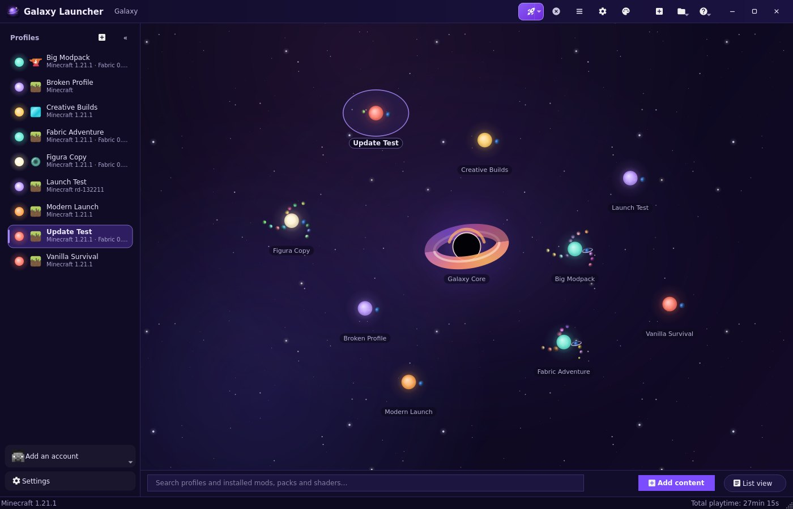
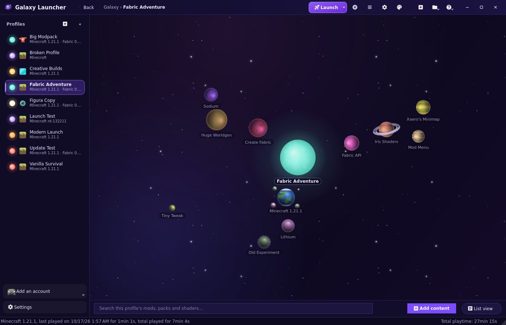
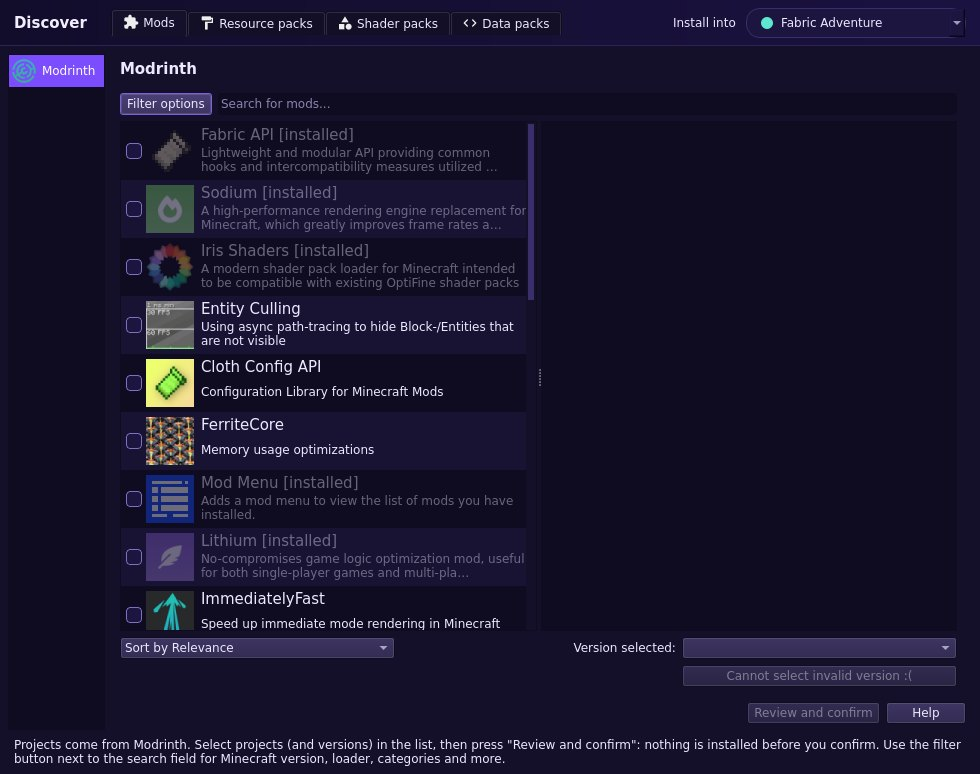
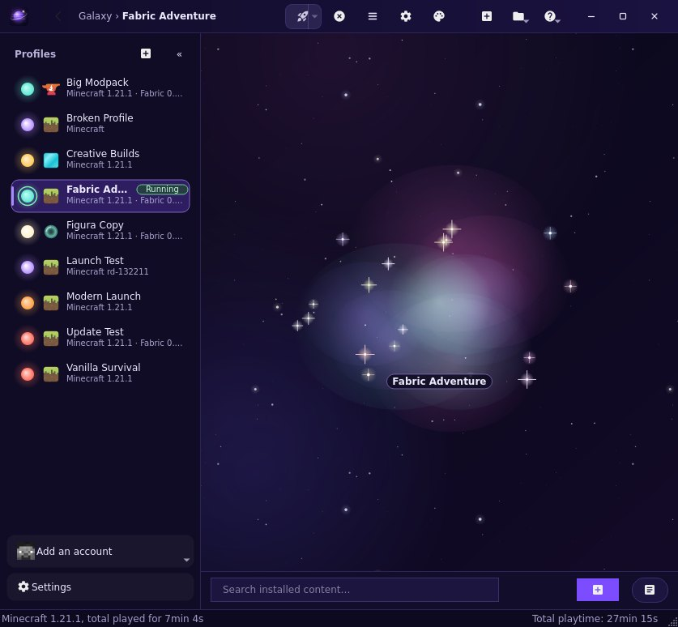
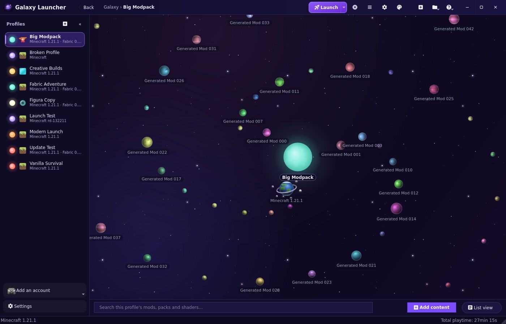
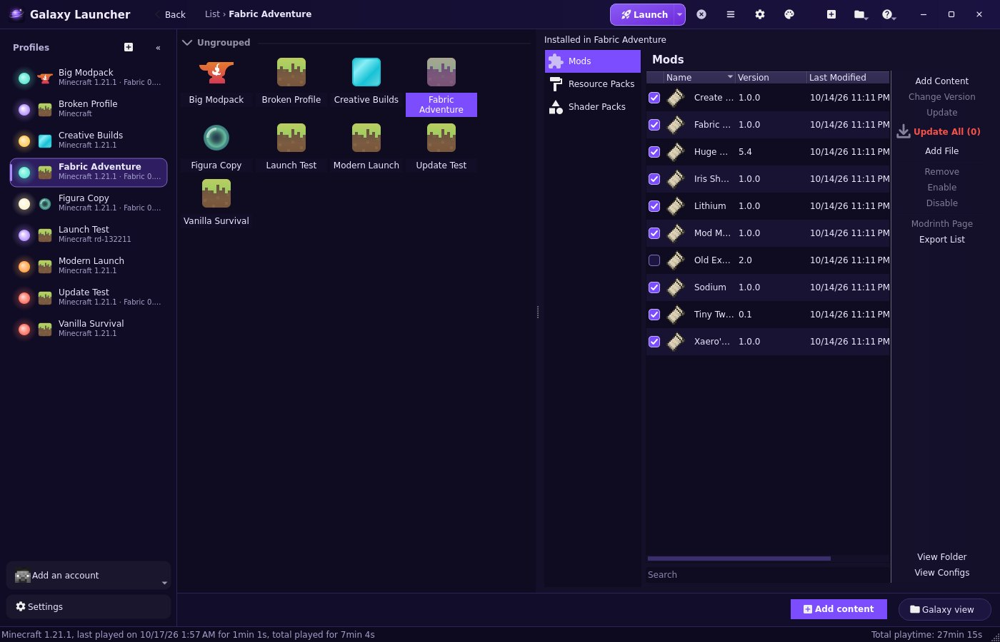
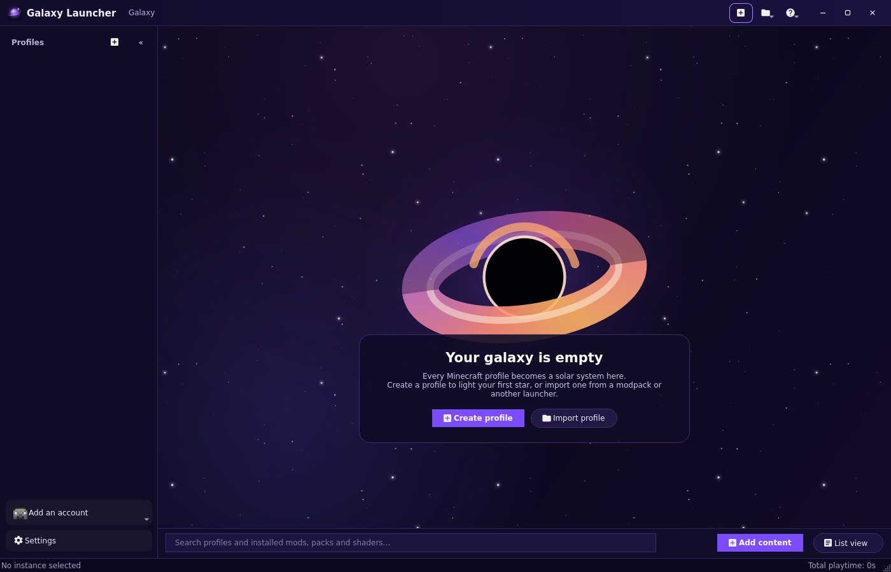

# Galaxy Launcher

Galaxy Launcher is Prism Launcher with a different front end: your Minecraft profiles form a galaxy you can fly
through. Everything shown is read from your real installations, and every action uses Prism's own code.

| In the galaxy | Stands for |
| --- | --- |
| Solar system | A profile (Prism instance) |
| Sun | The profile itself: click to launch, right-click to manage |
| Blue-green planet | The profile's Minecraft version and mod loader (the base game, not a mod) |
| Planet | An installed mod; its size follows the file size |
| Moon | A resource, texture or data pack; packs orbit the base game planet |
| Ring | A shader pack; rings sit around the shader loader mod (Iris, Oculus, OptiFine), else around the base game planet |

Your profiles orbit a black hole at the centre of the galaxy. Click it to launch your last played profile: it sends
a beam to that system, then the usual launch plays. Right-click it to choose another profile to launch (also in
Settings › Galaxy), rename it or centre the view. Inside a system, the black hole or another of your profiles now and
then drifts by far in the background, drawn the way the galaxy shows it. Whatever you point at stops moving (a planet, a moon or ring with its planet, or a profile while the rest of
the galaxy keeps turning), so it is easy to read and click.

At most three planets share an orbit, so planets stay well apart; large profiles get more orbits and open framed on
their inner orbits (zoom out to see all of it).

A dashed outline marks disabled content, a "!" badge marks content with problems, and a green ring plus a "Running"
badge marks a profile that is playing.

## Using it

| To | Do |
| --- | --- |
| Enter a solar system | Click it, or click the profile in the sidebar |
| Go back to the galaxy | Back in the top bar, Esc, Backspace, or the mouse's back button |
| Launch a profile | Click its sun (or Launch in the top bar, or double-click it in the sidebar) |
| Manage a profile | Right-click its sun or its sidebar entry: rename, sun color, icon, group, edit, folder, duplicate, export, shortcut, delete |
| See what a body is | Hover it |
| See project details | Click it (the details link to its Modrinth page when the launcher knows the source) |
| Manage content | Right-click a planet, moon or ring: update, change version, enable/disable, show in folder, details, delete |
| See available updates | Content with a newer version on Modrinth gets a red outline (dashed when it is also disabled) and a red "!" (its name is red in the list view); right-click › *Update to …*. Content that came with a modpack has its updates locked; updating it asks to unlock it first |
| Update everything | When a profile has updates, a red download arrow appears next to the search bar (and "Update All" in the list view): it lists every update with its changelog and installs the chosen ones together. Disabled content stays disabled |
| Add content | **Add content** (bottom bar, Ctrl+Shift+D) opens the Discover window: browse Modrinth by type (mods, resource packs, shader packs, data packs), use the filters (Minecraft version, categories, release type and more for every type; loader and environment for mods; shader loader for shaders), pick versions, then *Review and confirm*. Dependencies are added for you and nothing installs before you confirm. Right-clicking the base game planet opens it on a specific type. |
| Find installed content | Type in the bottom search bar: matches are highlighted (in the galaxy, profiles containing a match), the count is shown, and Enter jumps from match to match |
| Sign in with Microsoft | Sidebar › account button › Manage Accounts › Add Microsoft: your browser opens Microsoft's sign-in page, then returns to a Galaxy Launcher page on your computer |
| Switch views | The button at the bottom right (Ctrl+L) |
| Zoom and pan | Mouse wheel / + and −; drag, or arrow keys. Right-click empty space › Reset view |
| Use the keyboard | Tab and Shift+Tab move between objects, Enter activates, the Menu key opens the context menu, Ctrl+F jumps to search |

Launching plays a short sequence: the system collapses into its sun, and the sun explodes into a nebula in which
your mods, packs and shaders float as sparkles while you play (their names fade out when you press Launch; point
at a sparkle to see which one it is). Disabled content stays out of it: it moves away from the sun to one shared
orbit further out and circles there while you play. When the game stops, the sparkles fly back to their orbits, the nebula
condenses into the sun again and the names fade back in. It is purely cosmetic: it never touches your files and the game
starts right away through Prism's normal launch (accounts, Java, mod loaders, errors).

The window has its own minimize, maximize and close buttons in the top bar (drag empty top bar space to move it,
double-click to maximize, drag an edge to resize). Switching profiles from the sidebar flies out of the current
system and into the next one. With Discord running, your status shows "In the launcher" or "Playing <profile>"
with the loader and Minecraft version, the launcher's icon and your account's head.

Large collections spread over more orbits instead of shrinking; every body stays selectable.

The list view shows the profile selected in the sidebar as Prism's familiar Mods, Resource Packs, Shader Packs and
Data Packs pages. Both views show the same data; a change in one appears in the other. Right-clicking a project there
opens the same menu as in the galaxy, and *Update* brings the selected project to its latest version.

A new installation starts with an empty galaxy and buttons to create or import a profile.

## Updating Galaxy Launcher

At startup, Galaxy Launcher checks its GitHub releases. When a newer version exists, a red download arrow appears
right of the help (?) button: it shows what is new and how to update (the new installer on Windows, a one-line
command on Linux). Your profiles, accounts and settings are kept. The check can be turned off in Settings › Galaxy.

## Settings

*Settings › Galaxy* has the launch animation, reduce motion, orbit animation, background animation (the star field
drifts and moves in depth as you pan, zoom and travel), orbit paths (off by default), Discord Rich Presence,
background update checks, the system title bar instead of the launcher's window buttons, celestial quality (use
*Simple* on slow machines), star field, object size, spacing between systems, zoom speed and the startup view.
All other Prism settings, accounts and themes are where Prism has them; the *Galaxy* theme is the default and every
other theme remains available.

## Microsoft sign-in

Galaxy Launcher signs in with its own Microsoft application. Your browser opens Microsoft's sign-in page; afterwards
Microsoft sends it back to a small page the launcher serves on `http://localhost` (only reachable from your computer),
which tells you whether it worked. Accounts added with an earlier build that used another application ID need to be
added again.

Forks should use their own application: register it in Microsoft Entra (personal Microsoft accounts, platform
*Mobile and desktop applications* with the redirect URI `http://localhost`, *Allow public client flows* on), request
Minecraft API access for it from Mojang, then build with `-DLauncher_MSA_CLIENT_ID=<client ID>` or enter it in
Settings › APIs.

## For developers

* [Architecture and design decisions](ARCHITECTURE.md)
* [Flatpak packaging, permissions and API keys](../../flatpak/README.md)
